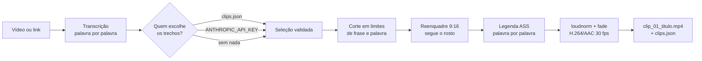

# 🎬 TikTok Clipper

**Transforma um vídeo longo em clipes verticais prontos para TikTok, Reels e Shorts, de forma automática.**

Você entrega um arquivo ou um link do YouTube. O programa transcreve a fala, usa o **Claude** para escolher os
melhores momentos, corta, reenquadra em 9:16 seguindo o rosto de quem fala, queima legenda palavra por palavra
e exporta clipes de 15 a 60 s com áudio normalizado.


---

## ✨ O que ele faz

- 🗣️ **Transcreve palavra por palavra** com faster-whisper, rodando local (usa GPU se houver, senão CPU).
- 🤖 **Escolhe os melhores trechos com IA.** O Claude lê a transcrição e indica os momentos mais fortes, com título e motivo.
- ✂️ **Corta em pontos seguros.** Início e fim se ajustam a limites de frase, e o corte cai na pausa entre palavras, nunca no meio de uma.
- 📱 **Reenquadra em 9:16 seguindo o rosto**, ou deixa o vídeo no centro com fundo desfocado.
- 💬 **Legenda animada palavra por palavra**, em estilos prontos (`tiktok`, `clean`, `neon`) ou criados por você.
- 🔊 **Normaliza o áudio** (loudnorm) e aplica fades. Exporta H.264/AAC a 30 fps.
- 💾 **Não enche o disco.** Com link do YouTube, baixa só o áudio para transcrever e depois só os trechos escolhidos.
- 🆓 **Funciona sem API.** Sem chave, usa um seletor local baseado em densidade de fala e pausas.

---

## 🔍 Como funciona



1. **Transcrição.** O áudio vira uma lista de palavras com início e fim exatos (`Word(start, end, text)`). O resultado fica em cache em JSON, então reprocessar o mesmo vídeo não retranscreve.
2. **Seleção dos trechos.** Há três caminhos, nesta ordem de prioridade:
   1. `--clips-file clips.json` usa uma lista que você mesmo escreveu, sem gastar créditos.
   2. Com `ANTHROPIC_API_KEY` no `.env`, o **Claude** escolhe. O modelo é configurável em `config.yaml`.
   3. Sem nenhum dos dois, o **fallback local** pega as janelas de frases com mais fala e menos pausas.

   Em todos os casos, a resposta é validada: itens inválidos ou sobrepostos são descartados.
3. **Reenquadre.** Detecção de rosto com OpenCV (Haar), suavizada por média móvel para a câmera não tremer, e crop 9:16.
4. **Legenda e render.** Gera um `.ass` com a palavra atual em destaque e renderiza com ffmpeg.

---

## 🚀 Começando

Requisitos: **Python 3.10+** (testado em 3.12).

```bash
git clone https://github.com/ribeirou/tiktok-clipper.git
cd tiktok-clipper
pip install -r requirements.txt
```

Para usar a IA na seleção dos trechos, copie `.env.example` para `.env` e coloque sua chave:

```bash
ANTHROPIC_API_KEY=sua-chave-aqui
```

Rode:

```bash
# a partir de um arquivo
python clipper.py video.mp4 --clips 5 --min 20 --max 60 --lang pt --output ./clips

# a partir de um link do YouTube
python clipper.py "https://youtu.be/XXXX" --clips 5
```

Você recebe `clip_01_titulo.mp4`, `clip_02_...` e um `clips.json` com os trechos escolhidos e o motivo de cada um.

> **ffmpeg:** usa o do PATH. Se não houver, usa o embutido do pacote `imageio-ffmpeg`.
> **GPU:** o faster-whisper usa CUDA automaticamente se cuBLAS/cuDNN estiverem instalados. Sem elas, cai para CPU sem erro.
> **Link do YouTube:** precisa de Node.js no PATH (o yt-dlp exige um runtime JS).

---

## ⚙️ Opções

| Flag | O que faz |
|---|---|
| `--clips N` | quantidade de clipes (padrão 5) |
| `--min` / `--max` | duração mínima e máxima em segundos (20 / 60) |
| `--lang` | idioma da fala; `auto` detecta (padrão `pt`) |
| `--transcriber` | `faster-whisper` (padrão) ou `voicestudio` |
| `--whisper-model` | `tiny`, `base`, `small` (padrão), `medium`, `large-v3` |
| `--layout` | `crop` (9:16 com rosto) ou `blur` (vídeo no centro, fundo desfocado) |
| `--no-face-track` | crop central fixo |
| `--remove-silence` | encurta pausas longas; as legendas acompanham |
| `--caption-style` | `tiktok`, `clean`, `neon` ou um estilo seu em `config.yaml` |
| `--output` | pasta de saída |
| `--clips-file` | usa um JSON de clipes em vez da API |
| `--transcript` | caminho do JSON de transcrição (lê se existir, senão grava) |
| `--transcribe-only` | só transcreve e sai |

Estilos de legenda, modelo do Claude, bitrate e fontes ficam em [`config.yaml`](config.yaml).

### 💰 Custo da API

Aproximadamente **US$ 0,01** por vídeo de 10 min e **US$ 0,20** por vídeo de 1 h com `claude-opus-5-5`. Para gastar menos, troque `claude_model` por um modelo menor no `config.yaml`.

### 🎙️ Transcritor alternativo

`--transcriber voicestudio` chama `POST {voicestudio_url}/v1/audio/transcriptions` com timestamps por palavra. Se o app estiver fechado ou a resposta vier sem palavras, o programa avisa e usa o faster-whisper.

### 💬 Legenda em um vídeo já editado

```bash
python burn_captions.py corte.mp4 palavras.json saida.mp4 --caption-style yellow
```

---

## 🗂️ Estrutura do projeto

```
clipper.py        CLI e orquestração do pipeline
transcribe.py     transcribe(path, lang) -> [Word(start, end, text)], backends e cache JSON
select_clips.py   arquivo / Claude / fallback, validação do JSON, ajuste a limites de frase
reframe.py        detecção de rosto (OpenCV Haar), média móvel, crop 9:16 e layout blur
captions.py       gera o .ass palavra por palavra
render.py         corte, remoção de silêncio, legenda, loudnorm, fade, exportação
fetch.py          entrada por URL (yt-dlp)
burn_captions.py  queima legenda em vídeo já editado
config.yaml       estilos de legenda, modelo do Claude, bitrate
test_pipeline.py  auto-checagem das partes lógicas
```

## 🧪 Testes

```bash
python test_pipeline.py
```

Verifica a validação da seleção de trechos e a geração das legendas. Imprime `ok` se passar.

## ⚠️ Limitações conhecidas

- A detecção de rosto usa o classificador Haar do OpenCV: é rápida e sem dependências extras, mas funciona melhor com rosto de frente. Com várias pessoas, segue o maior rosto.
- O fallback sem API usa densidade de fala e pausas, não a energia do áudio.
- O render é em CPU (libx264): cerca de 1 a 2 min por clipe de 40 s.

## 📌 Uso responsável

Use com vídeos seus ou com autorização de quem os fez. Cortar e publicar conteúdo de terceiros pode violar direitos autorais e os termos das plataformas.
